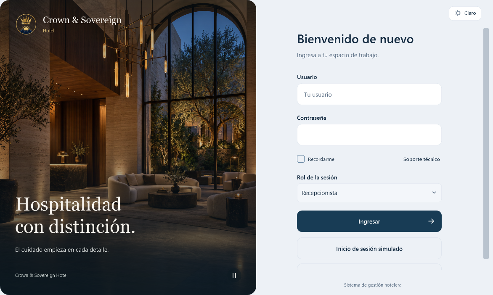

# Crown & Sovereign

Aplicación de escritorio para gestión hotelera, desarrollada en **WPF con C# y .NET Framework 4.7.2**.

La interfaz incluye el acceso, el panel operativo y trece módulos administrativos. Las
secciones de funcionamiento, reservas, habitaciones disponibles e ingresos cuentan con
flujos operativos de demostración; huéspedes y el inventario básico permiten altas y
cambios en memoria. La conexión a PostgreSQL y las operaciones CRUD de los módulos
administrativos siguen pendientes; ver [docs/PENDIENTES.md](docs/PENDIENTES.md).



## Repositorio del equipo

Destino: https://github.com/KarlSett/Crown-Sovering

Para publicar desde una terminal de PowerShell con acceso normal al proyecto:

```powershell
.\scripts\Publicar-Repositorio.ps1
```

El script conecta origin a ese repositorio, crea el commit de la entrega si hay cambios y sube main. Utiliza la identidad y autenticación de Git del equipo; no incluye tokens. Si origin apunta a otro destino o la rama actual no es main, se detiene sin sobrescribirlos. No utiliza force push.

Después de publicarlo, los integrantes pueden obtener el código con:

```powershell
git clone https://github.com/KarlSett/Crown-Sovering.git
```

## Abrir y ejecutar

1. Usar Windows y Visual Studio con la carga de trabajo **Desarrollo de escritorio de .NET** y el Developer Pack de **.NET Framework 4.7.2**.
2. Abrir `Crown &.sln`.
3. Seleccionar `Debug / Any CPU` e iniciar con **F5**.

El proyecto no requiere paquetes NuGet ni credenciales. `BtnIngresar` y
`BtnLoginSimulado` abren el panel con datos de demostración; no hay validación real.

Desde una consola de desarrollador de Visual Studio:

```powershell
msbuild '.\Crown &.sln' /t:Build /p:Configuration=Debug
```

## Estado de la entrega

- Ventana redondeada, con minimizar, maximizar/restaurar y **Salir**.
- Login con apariencia clara y oscura, navegación por teclado y estados visuales.
- Fondo hotelero local con movimiento suave y pausa; MP4 local opcional.
- Panel con barra lateral agrupada: Operación, Administración, Producto, Servicios y Configuración.
- Cuatro roles de demostración (Administrador, Gerente, Recepcionista, Personal de servicios):
  el menú muestra solo las pantallas de cada rol. La autorización real queda para el backend.
- Trece pantallas de módulo con acciones de demostración en memoria para huéspedes,
  inventario, estancias y llaves, cargos y facturas, caja, tarifas, convenios, limpieza,
  consumos, configuración, personal, notificaciones y reportes CSV.
- Las altas, filtros y operaciones principales se conservan durante la sesión; no persisten
  después de cerrar la aplicación.
- Funcionamiento: ocupación, disponibilidad, llegadas, salidas, ingresos del día y movimientos.
- Reservas: filtros, alta con validación de disponibilidad y operación de llegada/salida/cancelación.
- Habitaciones: disponibilidad por fechas, tipo de capacidad y calidad.
- Ingresos: cuentas de ingreso por concepto, medios de pago y detalle diario/semanal/trimestral.
- Sin autenticación real ni persistencia entre sesiones. Los pendientes de producción y las
  diferencias con el esquema están en [docs/PENDIENTES.md](docs/PENDIENTES.md).

## Organización

```text
Backend/
  Data/           Almacén de demostración (DatosHotel)
  Models/         Entidades y modelos de reportes
  Repositories/   Reservado para ADO.NET (ver README interno)
  Services/       Reglas de negocio (ServicioHotel)
Frontend/
  Assets/         Emblema, fotografía y vídeo opcional
  Controls/       KpiCard, SectionCard y StatusBadge
  Themes/         Colores y tipografía
  Styles/         Estilos del login y del panel
  Views/          LoginView, DashboardView, Sections/, Modules/ y Dialogs/
docs/
  ARQUITECTURA.md, DESIGN.md, INTEGRACION_BACKEND.md, MODULOS_Y_ROLES.md
  images/         Vistas de referencia
```

## Roles

La matriz pantalla → tablas → rol está en [docs/MODULOS_Y_ROLES.md](docs/MODULOS_Y_ROLES.md).
El menú se filtra por rol en el cliente (solo presentación); la autorización real
corresponde al backend.

## Para el equipo de backend

Comenzar por [la guía de integración](docs/INTEGRACION_BACKEND.md), que describe el
contrato de datos y las decisiones pendientes. La estructura general está en
[docs/ARQUITECTURA.md](docs/ARQUITECTURA.md) y el lenguaje visual, en
[docs/DESIGN.md](docs/DESIGN.md).

Las clases nuevas deben registrarse en el archivo `.csproj`: es un proyecto clásico, sin
inclusión automática de archivos C#. Visual Studio lo hace al añadir una clase desde el
proyecto.

Crear ramas de trabajo desde `main`, por ejemplo `backend/autenticacion`, y revisar los
cambios mediante pull requests. Evitar cambiar nombres de controles o archivos visuales
sin coordinar con frontend.

[Ver modo oscuro](docs/images/login-dark.png)

Las imágenes de referencia son renders del XAML compilado; no requieren que la carpeta
local de previsualizaciones forme parte del repositorio.
