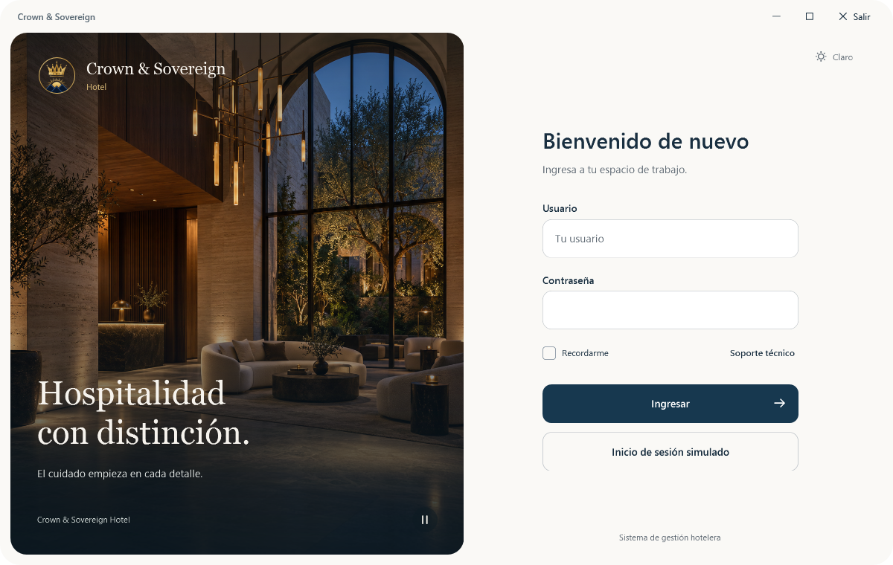

# Crown & Sovereign

Aplicación de escritorio para gestión hotelera, desarrollada en **WPF con C# y .NET Framework 4.7.2**.

Esta primera entrega contiene el **frontend del login** y la estructura para que el equipo de backend integre sus servicios. Los botones de ingreso, acceso simulado y soporte todavía no ejecutan acciones.



## Repositorio del equipo

Destino: https://github.com/KarlSett/Crown-Sovering

Para publicar esta entrega desde una terminal de PowerShell con acceso normal al proyecto:

```powershell
.\scripts\Publicar-Repositorio.ps1
```

El script conecta origin a ese repositorio, crea el commit de la entrega si hay cambios y sube main. Utiliza la identidad y autenticación de Git del equipo; no incluye tokens. Si origin apunta a otro destino o la rama actual no es main, se detiene sin sobrescribirlos. No utiliza force push.

Después de publicarlo, los integrantes pueden obtener el código con:

```powershell
git clone https://github.com/KarlSett/Crown-Sovering.git
```

## Abrir y ejecutar

1. Usar Windows y Visual Studio con la carga de trabajo **Desarrollo de escritorio de .NET** y el Developer Pack de **.NET Framework 4.7.2**.
2. Abrir `Crown &.sln`.
3. Seleccionar `Debug / Any CPU` e iniciar con **F5**.

El proyecto no requiere paquetes NuGet, base de datos ni credenciales para visualizar la interfaz.

Desde una consola de desarrollador de Visual Studio:

```powershell
msbuild '.\Crown &.sln' /t:Build /p:Configuration=Debug
```

## Estado de la entrega

- Ventana redondeada, con minimizar, maximizar/restaurar y **Salir**.
- Formulario con usuario, contraseña, Recordarme, soporte e ingreso.
- Apariencia clara y oscura, navegación por teclado y estados visuales.
- Fondo hotelero local con movimiento suave y pausa.
- Soporte de presentación para un MP4 local opcional; no se incluye vídeo.
- Sin autenticación, navegación tras ingresar, persistencia, consultas ni conexión a base de datos.

## Organización

```text
Frontend/
  Assets/         Emblema, fotografía y vídeo opcional
  Themes/         Colores y tipografía
  Styles/         Estilos y controles reutilizables
  Views/          LoginView.xaml y su código de presentación
Backend/
  Data/           Conexiones y configuración de datos (pendiente)
  Models/         Entidades (pendiente)
  Repositories/   Acceso a datos (pendiente)
  Services/       Casos de uso y reglas de negocio (pendiente)
docs/
  INTEGRACION_BACKEND.md
  images/         Vistas de referencia
```

## Para el equipo de backend

Comenzar por [la guía de integración](docs/INTEGRACION_BACKEND.md), que identifica los controles, su ubicación y las decisiones pendientes. La estructura general está en [ARQUITECTURA.md](ARQUITECTURA.md) y el lenguaje visual, en [DESIGN.md](DESIGN.md).

Las clases nuevas deben registrarse en el archivo `.csproj`: es un proyecto clásico, sin inclusión automática de archivos C#. Visual Studio lo hace al añadir una clase desde el proyecto.

Crear ramas de trabajo desde `main`, por ejemplo `backend/autenticacion`, y revisar los cambios mediante pull requests. Evitar cambiar nombres de controles o archivos visuales sin coordinar con frontend.

[Ver modo oscuro](docs/images/login-dark.png)

Las imágenes de referencia son renders del XAML compilado; no requieren que la carpeta local de previsualizaciones forme parte del repositorio.